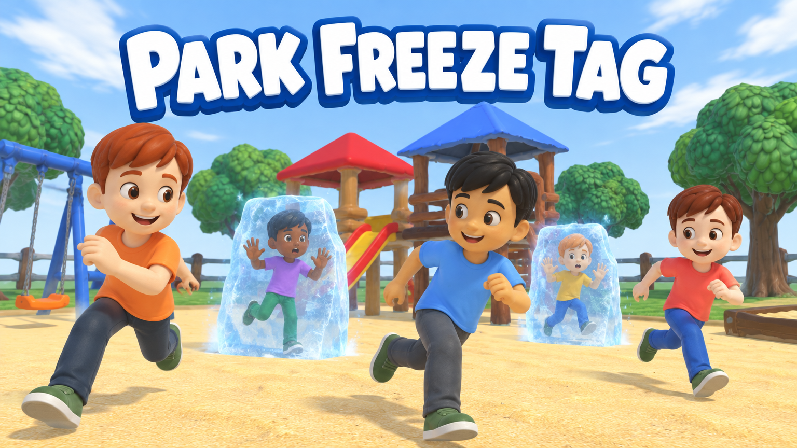
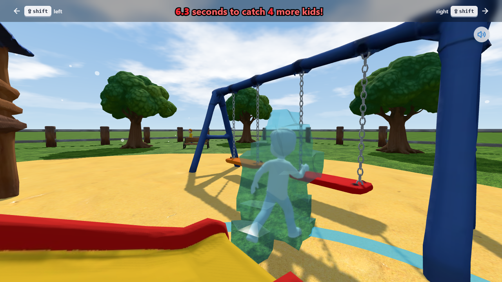

# Park Freeze Tag



**[Play it on itch.io](https://tinymicrobe.itch.io/park-freeze-tag)**

Ready or not, here you come! You're "it" in a game of freeze tag at the park. Five kids, twenty seconds. Get close and they freeze solid in a block of ice. Catch every one of them before the clock hits 0.0.

Made for GitHub Game Off 2026, theme **Shift**: the Shift keys are the only way to steer.

## How to play

You never stop running, so steering is everything.

| | Desktop | Phone or tablet (landscape) |
| --- | --- | --- |
| Start | Space | Tap |
| Turn left | Left Shift | Hold the left half of the screen |
| Turn right | Right Shift | Hold the right half of the screen |
| Play again | Any key | Tap |

- The kids dodge along the fence to escape the corners. Cut them off instead of chasing their tails.
- On Windows, tapping Shift five times quickly can bring up the Sticky Keys prompt. Choose **No**, or turn the shortcut off under Settings > Accessibility > Keyboard.



## Run it locally

You need Node.js. From the repository root:

```sh
make install   # install the game's dependencies
make serve     # start the dev server with live reload
make build     # build the game into game/dist
make preview   # serve the built game
make package   # build and zip the game for itch.io (game/release)
```

Run `make` on its own to list these targets.

## How it's built

- **Game:** React Three Fiber (three.js) with Vite and Tailwind CSS, in [`game/`](game). It renders in the browser with no server side.
- **Art:** the playground props and the kid started as AI-generated concept images, turned into 3D models with TRELLIS.2 on Comfy Cloud. They were then remeshed with Quad Remesher, baked to low-poly meshes with texture and normal maps, and rigged and animated in Blender. The five kids share one model with recoloured textures, plus frozen versions.
- **Music:** an original track made with ElevenLabs, cut into a bar-exact loop by [`tools/make_music_loop.py`](tools/make_music_loop.py).
- **Title art:** generated with an image model from in-game renders.

The Blender scenes live in `models.blend` (full detail) and `models_low.blend` (what the game uses). The scripts in [`tools/`](tools) build, bake, rig and export the assets through a Blender bridge. They need [pipenv](https://pipenv.pypa.io/): run `pipenv install --dev`, then `pipenv run python tools/<script>.py`. [`PROGRESS.md`](PROGRESS.md) has the working notes.

[`raw/`](raw) holds the original version of the game this one was rebuilt from.

## Credits

- Title font: [Luckiest Guy](https://fonts.google.com/specimen/Luckiest+Guy) by Astigmatic (Apache License 2.0)
- The 3D models, textures, title art and music were made with generative AI tools, then remeshed, rigged, animated and tuned for the browser.
